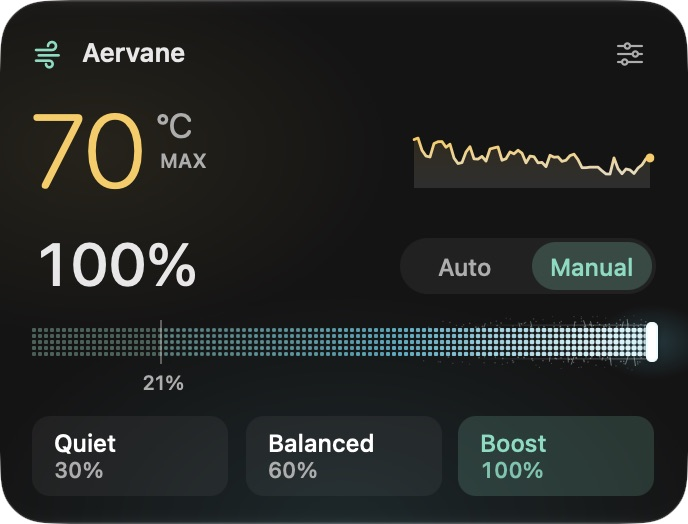
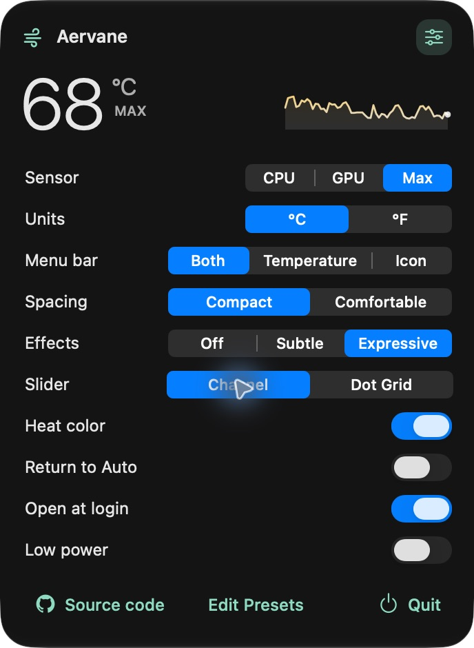

<p align="center">
  
</p>

<h1 align="center">Aervane</h1>
<p align="center">
  <a href="https://github.com/kirniy/aervane/actions/workflows/ci.yml"></a>
  
  <a href="LICENSE"></a>
</p>

A native Mac menu-bar utility with CPU temperature at a glance, direct percentage-based fan control, and editable presets in one glass panel. Built with Swift, AppKit, and a small C bridge to AppleSMC. No embedded browser, runtime packages, telemetry, or background network requests.

### Install

```sh
brew install --cask kirniy/tap/aervane
```

Apple Silicon · macOS 14+ · Developer ID signed and notarized. Open Aervane from Applications. On the first fan adjustment, macOS asks you to approve its embedded helper. Temperature monitoring works before setup.

Fan control is physically verified on the **M4 Mac mini (Mac16,10)**. Other models remain unverified; this release supports one fan. High temperature alone does not block manual control.

<p align="center">
  
</p>
<p align="center"><sub>Actual installed app at 100% cooling.</sub></p>

- A compact glass panel, heat-colored readings, and your choice of Cooling Channel or Dot Grid sliders. Cooling effects grow with speed and freeze into ice at maximum.
- Adjustable menu-bar content, spacing, slider style and effects. Animation responds to interaction; nothing loops while idle.
- Editable presets, temperature-history inspection, and keyboard controls.
- Manual control without a time limit by default. An optional 5–120 minute timer lives in Settings.

<details>
<summary>Original Dot Grid style</summary>
<p align="center">
  
</p>
</details>

<details>
<summary>Settings</summary>
<p align="center">
  
</p>
</details>

### Build locally

Requires a Mac and **Xcode 26.2 or newer** to compile the native glass interface. The resulting app targets macOS 14+, with a vibrancy fallback on versions before 26. Sensor compatibility is currently verified only on the M4 Mac mini.

```sh
git clone https://github.com/kirniy/aervane.git
cd aervane
export DEVELOPER_DIR=/Applications/Xcode.app/Contents/Developer
swift test
tools/build.sh
open dist/Aervane.app
```

For a development-signed build, set `SIGN_IDENTITY` to an identity from `security find-identity -v -p codesigning`. The default is ad hoc signing, suitable for read-only interface work. A Developer ID identity and notarization are required for the intended public distribution workflow.

### How control works

- Click the menu bar temperature to open or close the panel.
- Drag the fan slider or choose a preset. Before helper setup, the panel labels this as a preview; no fan write occurs.
- Fan speed means **percentage of the reported maximum speed**. Firmware limits apply: a Mac with a 21% minimum cannot be commanded to stop. The interface shows that limit explicitly.
- The helper is designed to return to automatic control after lost heartbeats, sensor failure, disconnection, or an optional timer the user enables. Manual control has no time limit by default. High temperature is informational; hardware speed limits still apply. Normal restoration is verified; fault scenarios need broader hardware validation.

### Development

Start with [HANDOFF.md](HANDOFF.md) for current work, acceptance criteria, and validation gaps. [PRODUCT.md](PRODUCT.md) captures the brief; [DESIGN.md](DESIGN.md) records the native design system. See [hardware findings](docs/reverse-engineering.md), [model/key catalog](docs/compatibility/mfc-1.5.21/README.md), [verification](docs/verification.md), and [resource measurements](docs/performance.md).

Update with `brew upgrade --cask kirniy/tap/aervane`. The app does not poll for updates. The [Homebrew tap](https://github.com/kirniy/homebrew-tap) pins each release checksum; the [distribution runbook](docs/distribution.md) documents signing, notarization and publication.

### License

[MIT](LICENSE). Independently implemented. No proprietary app binaries, assets, or decompiled code are included. The GitHub mark is credited in [third-party notices](THIRD_PARTY_NOTICES.md).
