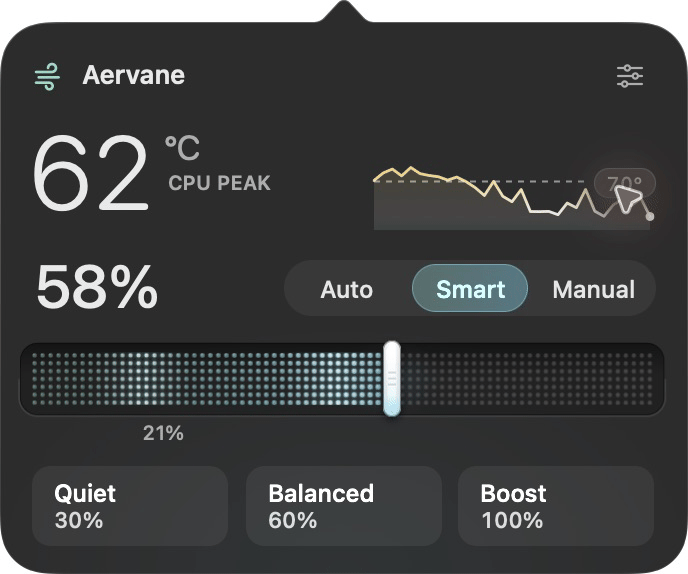
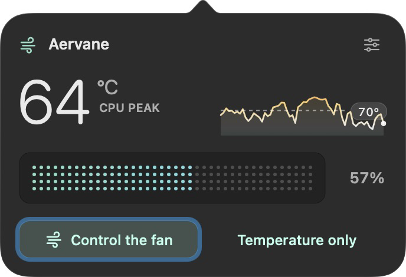

<p align="center">
  
</p>

<h1 align="center">Aervane</h1>
<p align="center">
  <a href="https://github.com/kirniy/aervane/actions/workflows/ci.yml"></a>
  
  <a href="LICENSE"></a>
</p>

A native Mac menu-bar utility with CPU temperature at a glance, direct percentage-based fan control, and editable presets in one glass panel. Built with Swift, AppKit, and a small C bridge to AppleSMC. No embedded browser, runtime packages, telemetry, or background network requests.

### Install

```sh
brew install --cask kirniy/tap/aervane
```

Intel & Apple Silicon · macOS 13+ · Developer ID signed and notarized. Open Aervane from Applications. The first launch opens a short introduction in the menu-bar panel. Choose temperature monitoring alone, or preview the fan controls and explicitly set up the signed helper. [First-run guide](docs/first-run.md).

One universal app for Intel and Apple Silicon: model-aware temperatures, linked control of every detected fan, and temperature monitoring on fanless Macs. Each fan follows its own firmware limits. High temperature alone does not block manual control. [Mac compatibility](docs/mac-compatibility.md).

<p align="center">
  
</p>
<p align="center"><sub>Aervane 0.4.0 in Smart mode. Dark appearance; Reduce Transparency enabled.</sub></p>

- A compact glass panel, heat-colored readings, Dot Grid by default, and an optional Cooling Channel. Cooling effects grow with speed.
- Adjustable menu-bar content, spacing, slider style and effects. Channel’s miniature fans follow measured RPM; Dot Grid carries a light wave at every nonzero measured speed. Motion stops when the panel closes.
- Editable presets, temperature-history inspection, and keyboard controls. Hold ⌘ to reveal the shortcuts. Temperature changes use a short crossfade with stable-width digits.
- Auto · Smart · Manual. [Smart cooling](docs/smart-cooling.md) works toward a temperature you choose: it anticipates rising heat and adjusts cooling around the target, easing as temperatures fall through a small deadband. Drag the target directly on the graph, or adjust it with `[` and `]`. It can't guarantee a cap under every load.
- Temperature-only mode with no helper setup. A failed fan read does not erase valid temperature readings.
- Manual control without a time limit by default. An optional 5–120 minute timer lives in Settings.

<details>
<summary>Dot Grid · live motion</summary>
<p align="center">
  
</p>
</details>

<details>
<summary>First launch</summary>
<p align="center">
  
</p>
</details>

<details>
<summary>Settings</summary>
<p align="center">
  
</p>
</details>

### Build locally

Requires a Mac and **Xcode 26.2 or newer**. The app targets macOS 13+ and uses one native frosted AppKit material for the panel and its pointer. The build produces universal arm64/x86_64 application and helper executables.

```sh
git clone https://github.com/kirniy/aervane.git
cd aervane
export DEVELOPER_DIR=/Applications/Xcode.app/Contents/Developer
swift test
tools/build.sh
open dist/Aervane.app
```

For a development-signed build, set `SIGN_IDENTITY` to an identity from `security find-identity -v -p codesigning`. The default is ad hoc signing, suitable for read-only interface work. A Developer ID identity and notarization are required for the intended public distribution workflow.

### How control works

- Click the menu bar temperature to open or close the panel.
- Drag the fan slider or choose a preset. Before helper setup, the panel labels this as a preview; no fan write occurs.
- Fan speed means **percentage of the reported maximum speed**. Firmware limits apply: a Mac with a 21% minimum cannot be commanded to stop. The interface shows that limit explicitly.
- The helper is designed to return to automatic control after lost heartbeats, sensor failure, disconnection, or an optional timer the user enables. Manual control has no time limit by default. High temperature is informational; hardware speed limits still apply. Multi-fan writes are transactional: modes, aggregate gate where required, targets, then verified readback. Failed operations restore the owned fans to Auto.

### Development

Start with [HANDOFF.md](HANDOFF.md) for current work, acceptance criteria, and validation gaps. [PRODUCT.md](PRODUCT.md) captures the brief; [DESIGN.md](DESIGN.md) records the native design system. See [hardware findings](docs/reverse-engineering.md), [model/key catalog](docs/compatibility/mfc-1.5.21/README.md), [verification](docs/verification.md), and [resource measurements](docs/performance.md).

Update with `brew upgrade --cask kirniy/tap/aervane`. The app does not poll for updates. The [Homebrew tap](https://github.com/kirniy/homebrew-tap) pins each release checksum; the [distribution runbook](docs/distribution.md) documents signing, notarization and publication.

### License

[MIT](LICENSE). Independently implemented. No proprietary app binaries, assets, or decompiled code are included. The GitHub mark is credited in [third-party notices](THIRD_PARTY_NOTICES.md).
